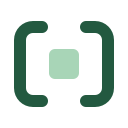
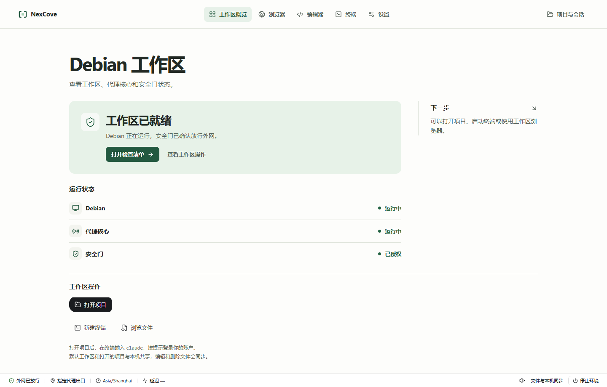
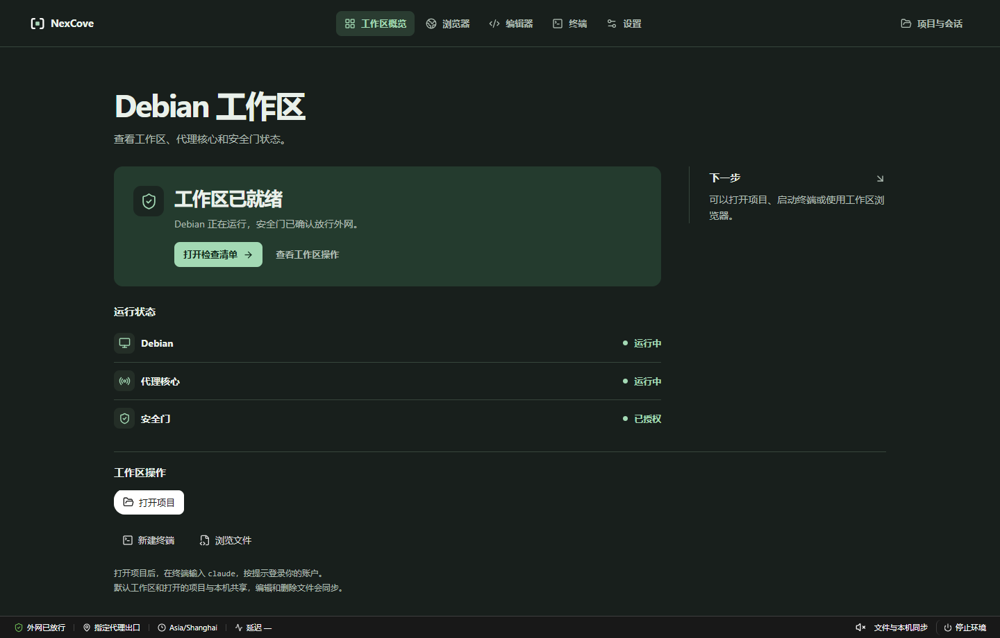

<picture>
  <source media="(prefers-color-scheme: dark)" srcset="assets/nexcove/logo-dark.svg">
  
</picture>

# NexCove

**Your space. Your environment.**

An isolated workspace for AI coding and development tools. NexCove brings a Debian workspace to Windows and presents guest, proxy, network and dedicated profile status in one place.

[简体中文](README.md) · [Roadmap](ROADMAP.md) · [Early offline prototype](preview/)

**This repository is a project preview. The full application source is still pending, and the Windows portable build remains private.**

## Workspace preview

The screenshots use offline synthetic scenarios.

## Credits and licenses

NexCove is derived from [Claude Cage](https://github.com/Lee-xeo/Claude-Cage) and [agent-vm](https://github.com/sylvinus/agent-vm). Original authors, contributors and third-party notices are credited in the [MIT license](LICENSE), [NOTICE](NOTICE) and [third-party licenses](THIRD_PARTY_LICENSES).
