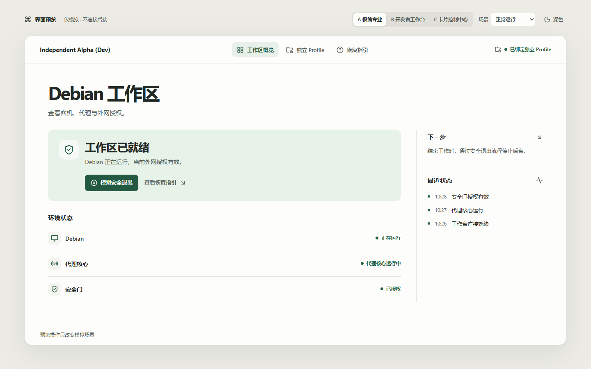
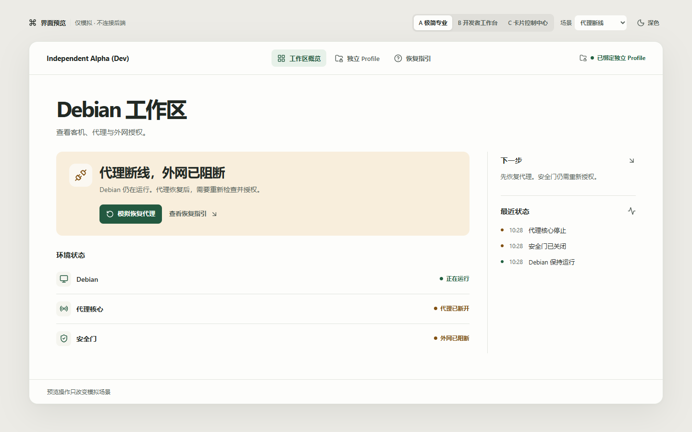

# Claude Cage Independent 项目预览

这个独立衍生项目探索 Windows 主机上的 Debian 工作区体验。工作区首页集中展示客机、代理和联网状态，设置和首次启动围绕专用 Profile 组织。

**当前公开范围是项目介绍、路线图和离线界面原型。完整应用源码尚未发布，当前没有公开的 Windows 下载。**

## 界面预览

以下截图来自合成场景，用于展示工作区布局和状态提示。

### 工作区就绪

### 代理断线

将 [离线原型目录](preview) 保存到本地后，在浏览器中打开 [index.html](preview/index.html) 即可查看。需要了解后续安排时，请阅读 [项目路线图](ROADMAP.md)。

## 来源与许可

独立项目源自 [Claude Cage](https://github.com/Lee-xeo/Claude-Cage) 和 [agent-vm](https://github.com/sylvinus/agent-vm)。保留原作者、贡献者和第三方组件署名。仓库自有内容适用 [MIT](LICENSE)，第三方内容适用相应条款，见 [NOTICE](NOTICE)、[第三方许可证](THIRD_PARTY_LICENSES) 和 [预览附带声明](preview/THIRD-PARTY-NOTICES.txt)。
