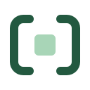
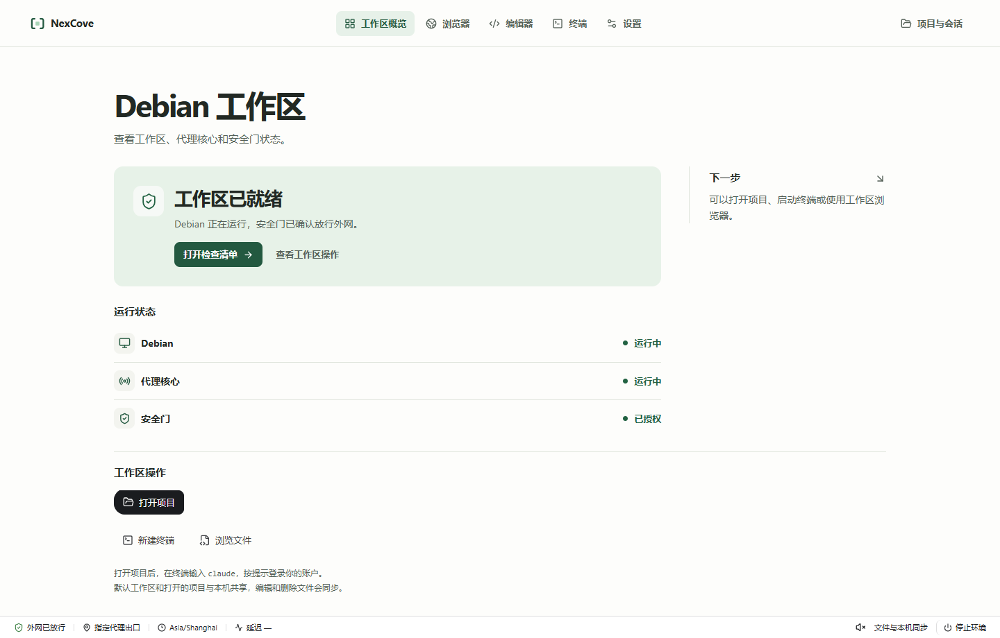
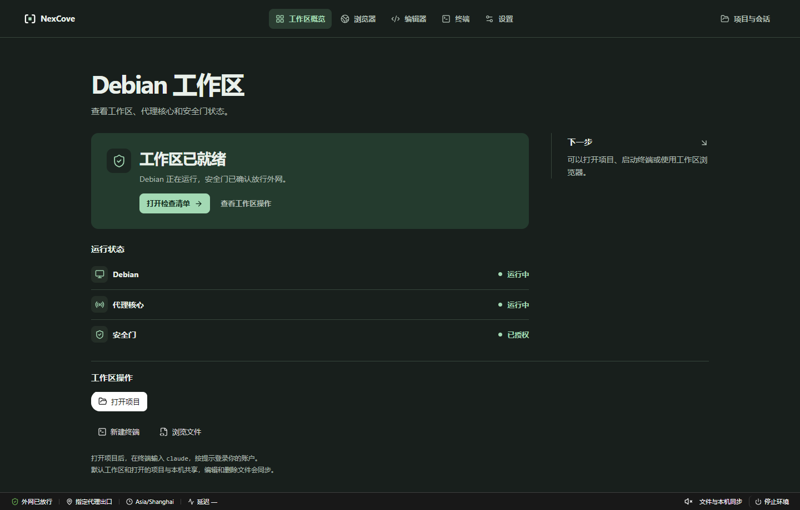

<picture>
  <source media="(prefers-color-scheme: dark)" srcset="assets/nexcove/logo-dark.svg">
  
</picture>

# NexCove

**独立空间，自由开发。**

面向 AI 编程与开发工具的独立隔离工作区。NexCove 在 Windows 主机上组织 Debian 工作区，并在一个界面中展示客机、代理、联网与专用 Profile 状态。

[English](README.en.md) · [项目路线图](ROADMAP.md) · [早期离线原型](preview/)

**这是项目预览。完整应用源码尚未发布，Windows 便携包暂不提供公开下载。**

## 工作区预览

以下为离线合成场景，用于展示界面。

## 来源与许可

NexCove 源自 [Claude Cage](https://github.com/Lee-xeo/Claude-Cage) 与 [agent-vm](https://github.com/sylvinus/agent-vm)。保留原作者、贡献者和第三方组件署名。查看 [MIT 许可证](LICENSE)、[NOTICE](NOTICE) 和[第三方许可证](THIRD_PARTY_LICENSES)。
